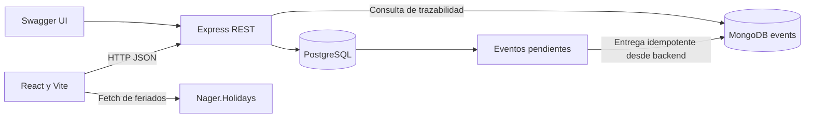

# BarberBook · Hito 3

**Integrante:** Martin Cerpa Diaz. Proyecto académico de Desarrollo Web y Móvil, segundo semestre de 2026. Solo utiliza datos ficticios.

BarberBook organiza reservas anticipadas de servicios de barbería y una fila presencial de atención. El cliente elige profesional, servicio, fecha y hora. El profesional confirma/rechaza solicitudes, consulta su agenda y administra turnos por sucursal y módulo.

## Continuidad con Taller 2

Se continúa en el mismo repositorio y carpeta, desde `e84fc039ac2b03e479bad2cb62e4f6bb7d12e3e3`, conservando su historial, React, Vite, el perfil público, pasos de reserva, tarjetas, estilos responsive, tema visual y Nager.Holidays. Se preservan el [README del Taller 2](docs/taller2-README.md) y sus 74 pruebas.

El Hito 3 incorpora Express, PostgreSQL, MongoDB, Swagger, sucursales, profesionales, módulos y turnos. La interfaz activa consulta la API; no lee ni migra reservas de localStorage. El código local anterior se conserva como referencia bajo pruebas, sin rutas activas que lo utilicen como alternativa ante una falla de API. El tema sigue siendo una preferencia del navegador y el portafolio es contenido decorativo estático.

La ampliación se relaciona con el caso 3.3 «Sistema de turnos»: los barberos son funcionarios y los sillones son módulos. Una reserva ocupa un intervalo futuro; un turno ocupa una posición en una fila y se asigna al llamarlo. **Esta justificación no acredita aprobación del docente.** La validación académica y defensa individual siguen pendientes.

## Funcionalidades implementadas

- Perfil y selección de profesional, catálogo activo de su sucursal y disponibilidad SQL.
- Solicitud, confirmación, rechazo, cancelación, reprogramación, agenda, cierre e inasistencia.
- Alta, consulta, edición y desactivación de sucursales, servicios, barberos y módulos.
- Jornadas semanales y bloqueos puntuales por profesional.
- Emisión, llamado FIFO, asignación, finalización y cancelación de turnos presenciales.
- Clientes ficticios, ingresos de reservas completadas y métricas de espera/atención.
- Historial operacional SQL y trazabilidad real consultada desde MongoDB.
- Carga, error, vacío, éxito, reintento y actualización del panel cada 15 segundos.

## Arquitectura



El [diseño técnico](docs/hito3-arquitectura.md) explica entidades, reglas, concurrencia y endpoints. `server/` separa rutas, controladores, validaciones, servicios, repositorios, configuración y migraciones. `src/services/api.js` concentra HTTP y `src/components/fullstack/` presenta las operaciones remotas.

Versiones verificadas: Node 24.20, React 19.2, Vite 8.3, Express 5.3, PostgreSQL 18 y MongoDB 8.0.17. `package-lock.json` fija las versiones exactas instaladas.

## Docker Compose

Requiere Docker Engine con Compose v2 o Docker Desktop iniciado. **Docker no estaba instalado en este equipo:** la configuración se entrega, pero el levantamiento real de Compose queda pendiente. La ejecución nativa con ambas bases reales sí fue probada.

```powershell
Copy-Item .env.example .env  # solo si todavía no existe .env
# Editar .env: reemplazar ambas contraseñas de ejemplo por valores locales.
docker compose up --build -d
docker compose ps
```

Usar contraseñas alfanuméricas para simplificar las URI del entorno académico. No publicar `.env`. Compose construye las URI internas con `postgres` y `mongo`; no utiliza las URI nativas del equipo.

| Servicio | Dirección del equipo | Persistencia |
| --- | --- | --- |
| React/Nginx | http://localhost:5174 | Imagen construida con Vite |
| API | http://localhost:3003/api | Migraciones al iniciar |
| Swagger | http://localhost:3003/api/docs/ | OpenAPI generado desde las rutas |
| PostgreSQL | `127.0.0.1:55433` | Volumen `barberbook-hito3-academico_academic-postgres` |
| MongoDB | `127.0.0.1:27028` | Volumen `barberbook-hito3-academico_academic-mongo` |

La red y los volúmenes pertenecen a `barberbook-hito3-academico`. `docker compose stop` detiene sus servicios conservando datos. No usar `down -v` para detener una demostración. No ejecutar Compose y la modalidad nativa simultáneamente: comparten puertos académicos.

## Ejecución nativa en Windows

Requiere Node 24 y binarios PostgreSQL 18. El script crea un **clúster separado en `.runtime/postgres`**, con autenticación SCRAM y puerto 55433. No utiliza ni modifica el servicio PostgreSQL de otros proyectos. Si los binarios están en otra ruta, definir `ACADEMIC_PG_BIN`.

Desde `C:\Users\Martin\barberbook-taller-2`, usar tres terminales:

```powershell
# Terminal 1: instalación inicial y bases
npm ci --ignore-scripts
npm run db:local

# Terminal 2
npm run api

# Terminal 3
npm run dev
```

Si falta `.env`, `db:local` lo genera con contraseñas aleatorias sin imprimirlas. Si ya existe, lo conserva. MongoDB se descarga la primera vez mediante `mongodb-memory-server`: se ejecuta **mongod real, autenticado, con WiredTiger persistente** en `.runtime/mongo`. No es un mock ni un repositorio en memoria; el nombre del paquete corresponde a su herramienta de arranque. Requiere Internet y espacio para la descarga inicial.

- Frontend: http://127.0.0.1:5174/
- Panel: http://127.0.0.1:5174/#/panel/dashboard
- Swagger: http://127.0.0.1:3003/api/docs/
- Salud: http://127.0.0.1:3003/api/health

Ctrl+C detiene los procesos Node; la terminal de bases detiene MongoDB sin borrar sus datos. PostgreSQL permanece iniciado. Para detener exclusivamente el clúster académico:

```powershell
& 'C:\Program Files\PostgreSQL\18\bin\pg_ctl.exe' -D .runtime/postgres -m fast -w stop
```

## Datos, reglas y API

Las migraciones se registran en `schema_migrations` y se aplican una sola vez. La semilla crea una sucursal ficticia, Matías, un sillón y tres servicios: `haircut` (45 min), `haircut-beard` (60 min), `beard` (30 min). No se inventan reservas o turnos al recargar. Usar «Cliente Demo» y `+56900000001` como datos ficticios.

Jornada inicial: lunes a viernes 10:00–13:00 y 15:00–19:00; sábado 10:00–16:00; domingo cerrado. Para demostrar un llamado presencial, hacerlo dentro de jornada o configurar una jornada válida en Administración. La duración debe caber antes del cierre y no invadir reservas ni bloqueos. Los feriados informan, sin cerrar automáticamente.

Swagger contiene solicitudes, respuestas y errores de todos los endpoints. Contrato JSON: `/api/openapi.json`. Recursos bajo `/api`: `/branches`, `/professionals`, `/services`, `/modules`, `/availability`, `/bookings`, `/tickets`, `/metrics`, `/customers`, `/history`, `/events` y `/health`.

Reservas pendientes y confirmadas ocupan toda su duración. La base rechaza solapamientos incluso ante concurrencia. Los reintentos con el mismo `id` son idempotentes. Confirmar y reprogramar revalidan disponibilidad. Completar requiere alcanzar el término previsto; inasistencia requiere 15 minutos desde el inicio. Los catálogos se desactivan sin borrar historial.

MongoDB conserva entidad, acción, fecha y metadatos de transición; no copia clientes, catálogos ni reservas completas. El outbox SQL permite reintentar la entrega si MongoDB falla. La consulta de eventos lee la colección real.

## API pública

Se conserva [Nager.Holidays](https://nagerholidays.com/api): `GET https://nagerholidays.com/api/v4/Holidays/CL/{year}`. React muestra feriados nacionales en fechas y agenda, con carga, traducción al español, error y reintento. Se consulta desde frontend porque entrega contexto sin enviar datos de clientes. Su indisponibilidad no impide reservar.

## Pruebas y documentación

```powershell
npm test
npm run test:integration
npx playwright install chromium  # una vez para pruebas de navegador
npm run test:e2e
npm run lint
npm run build
npm audit
```

`npm test` ejecuta pruebas históricas y unitarias; declara explícitamente que omite la suite que necesita bases. `test:integration` usa bases reales nuevas con prefijo `barberbook_hito3_test_`. `test:e2e` inicia API 3004 y Vite 5175 en este repositorio, con bases nuevas `barberbook_hito3_e2e_`. Solo estas bases nuevas reciben una jornada amplia para independizar las pruebas del día de ejecución. Se conservan como evidencia; no se eliminan bases existentes.

Ver [resultados](docs/hito3-validacion.md), [matriz de los 100 puntos](docs/hito3-cumplimiento.md) y [guion de defensa](docs/hito3-defensa.md).

## Limitaciones

- Panel académico sin autenticación ni sesiones; `users.role` modela actores. Mantenerlo en localhost y usar datos ficticios.
- Docker pendiente de instalación/inicio y ejecución real por el usuario.
- Preferencias operacionales locales antiguas, aprobación automática, penalizaciones y deshacer no se trasladan automáticamente al servidor. El flujo actual usa confirmación manual y transiciones explícitas; el código anterior permanece preservado.
- El panel consulta hasta 500 reservas, turnos y clientes; muestra 100 eventos e hitos recientes. No tiene paginación avanzada. Las métricas son acumuladas sobre toda la base SQL.
- Sin pagos, mensajería, notificaciones push ni aplicación React Native; esta última corresponde al Hito 4.
- Revisión personal, defensa y validación académica de la adaptación pendientes.

## Uso de Inteligencia Artificial

Se utilizó **OpenAI Codex** para analizar los documentos entregados, implementar API, migraciones, integración React, Compose, pruebas y documentación.

Prompt representativo del usuario: «Transformar BarberBook del Taller 2 en una plataforma Full Stack funcional, manteniendo las reservas para barberías como núcleo», con Express, PostgreSQL, MongoDB, Swagger y Docker, sin cambiar de repositorio ni hacer push o merges.

Resultado: persistencia real, interfaz integrada, pruebas y documentación. Codex ejecutó verificaciones automáticas y revisó capturas; esto **no sustituye validación humana**. La revisión de código, correcciones personales, decisiones comprendidas y aprendizajes del estudiante quedan pendientes de registrar después de su revisión. No se atribuyen aprendizajes ni una defensa que no hayan ocurrido.
