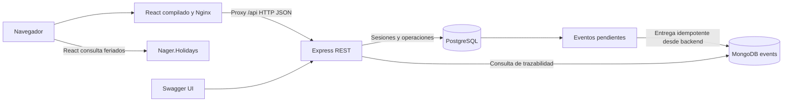

# BarberBook · Hito 3

**Integrante:** Martin Cerpa Diaz. Proyecto académico de Desarrollo Web y Móvil, segundo semestre de 2026. Solo utiliza datos ficticios.

BarberBook organiza reservas de horas para barberías. El cliente reserva sin crear una cuenta; el profesional inicia sesión para gestionar su jornada, solicitudes, agenda, clientes, servicios e ingresos.

Resuelve la coordinación de solicitudes y disponibilidad de una barbería: centraliza las horas, evita solapar atenciones confirmadas y conserva el historial e importe de cada atención. Sus usuarios objetivo son **clientes**, que consultan servicios y solicitan una hora sin cuenta, y **profesionales**, que administran su jornada e ingresos. La reserva por horario es el recorrido principal del producto.

## Continuidad con Taller 2

Se continúa en el mismo repositorio y carpeta, desde `e84fc039ac2b03e479bad2cb62e4f6bb7d12e3e3`, conservando su historial, React, Vite, el perfil público, pasos de reserva, tarjetas, estilos responsive, tema visual y Nager.Holidays. Se preservan el [README del Taller 2](docs/taller2-README.md) y sus 74 pruebas.

El Hito 3 incorpora Express, PostgreSQL, MongoDB, autenticación, Swagger y Docker Compose. Recupera el panel original (`AdminPanelPage`, Dashboard «Tu jornada», Solicitudes, Agenda, Clientes, Finanzas, Servicios y Ajustes) y conecta sus servicios a la API. No lee ni migra reservas de localStorage ni utiliza datos locales como alternativa ante errores. El tema sigue siendo una preferencia del navegador y el portafolio es contenido decorativo estático.

La referencia de producto es [BarberBook, rama main](https://github.com/MartinCerpa/BarberBook/tree/main): se consultaron sus decisiones, roadmap, feedback, seis guías de producto/UX/arquitectura/pruebas y componentes originales. Ese repositorio no fue modificado. El propietario señala que BarberBook fue aprobado como plataforma de reservas en el Taller 2; aquí se preserva ese producto.

Sucursales, módulos y FIFO se conservan como **extensión del caso oficial 3.3 «Sistema de turnos»**, accesible separadamente en `#/academic/queue` con permiso administrativo. No forman parte del Dashboard ni de la navegación principal. Su pertinencia para la entrega debe revisarse con el docente: la aprobación del Taller 2 no demuestra aprobación de esta adaptación del Hito 3.

## Funcionalidades implementadas

- Perfil de Matías; selector solo cuando existe más de un profesional público activo. Los registros técnicos permanecen conservados y ocultos del perfil.
- Login profesional, sesión HttpOnly, logout, protección de endpoints y aislamiento por profesional; reserva pública sin cuenta.
- Solicitud, confirmación, rechazo, cancelación, reprogramación, agenda, cierre e inasistencia.
- Alta, consulta, edición y desactivación de sucursales, servicios, barberos y módulos.
- Jornadas semanales y bloqueos puntuales por profesional.
- Emisión, llamado FIFO, asignación, finalización y cancelación de turnos presenciales.
- Historial de clientes por profesional, precio histórico e ingresos exclusivamente de atenciones completadas. Finanzas conserva Hoy, Esta semana y Este mes.
- Confirmación manual/automática, vencimiento de solicitudes, deshacer limitado, ajustes operacionales con guardado validado y perfil con guardado manual.
- Historial operacional SQL y trazabilidad real consultada desde MongoDB.
- Carga, error, vacío, éxito, reintento y actualización del panel cada 15 segundos.


El Taller 2 aportó la experiencia de reserva, navegación, panel y API de feriados. El Hito 3 incorpora servidor propio, autenticación, datos compartidos y persistentes, reglas transaccionales, trazabilidad, documentación REST y ejecución de los cuatro servicios.

## Arquitectura Full Stack



`server/` separa rutas, controladores, validaciones, servicios, repositorios, configuración y migraciones. `src/services/api.js` concentra HTTP; `remoteState.js` mantiene una copia del estado remoto en memoria. Los componentes originales presentan la operación profesional; `src/components/fullstack/` conserva la extensión académica. PostgreSQL es la fuente de verdad operacional: no existe respaldo de reservas en localStorage ante una falla de API.

### Tecnologías y versiones verificadas

Versiones comprobadas el 8 de noviembre de 2026, mediante los binarios en ejecución y `npm ls --depth=0`:

| Componente | Versión observada | Función |
| --- | --- | --- |
| Node.js / npm locales | 24.20.0 / 11.19.0 | Herramientas, credenciales y pruebas |
| Node.js en Docker | 24.22.2 | API y construcción del frontend |
| React / React DOM | 19.2.8 | Interfaz original y componentes |
| Vite / Bootstrap | 8.3.6 / 5.3.8 | Construcción y estilos |
| Express / Zod | 5.3.0 / 4.6.7 | API REST y validaciones |
| PostgreSQL / driver `pg` | 18.6 / 8.23.1 | Persistencia relacional |
| MongoDB / driver `mongodb` | 8.0.34 / 7.8.0 | Eventos documentales |
| Nginx | 1.28.3 | Frontend compilado y proxy |
| Swagger UI Express | 5.0.1 | Exploración de endpoints |
| Playwright / Supertest / Oxlint | 1.65.0 / 7.3.2 / 1.80.0 | Navegador, integración y lint |
| Docker Engine / Compose | 29.9.2 Linux / 5.6.1 | Ejecución de servicios |

`package-lock.json` fija las dependencias npm. Las imágenes usan etiquetas `node:24-alpine`, `postgres:18-alpine`, `mongo:8.0` y `nginx:1.28-alpine`: sus revisiones pueden cambiar en descargas futuras; la tabla identifica las versiones efectivamente comprobadas.

## Variables de entorno

La plantilla pública es [`.env.example`](.env.example). Copiarla a `.env` únicamente si ese archivo no existe y configurar valores locales. `.env`, `.runtime/`, `.codex-tmp/`, dependencias y resultados de pruebas están excluidos de Git; los secretos también se excluyen del contexto Docker.

| Variables | Uso y configuración |
| --- | --- |
| `POSTGRES_USER`, `POSTGRES_PASSWORD` | Usuario y contraseña locales de PostgreSQL; sustituir la contraseña de ejemplo |
| `MONGO_USER`, `MONGO_PASSWORD` | Usuario y contraseña locales de MongoDB; sustituir la contraseña de ejemplo |
| `POSTGRES_DB` | La plantilla declara `barberbook_hito3`; Compose y el script nativo usan ese nombre fijo |
| `DATABASE_URL` | Conexión PostgreSQL del equipo para pruebas, ejecución nativa y `auth:setup`; puerto 55433 |
| `MONGODB_URI`, `MONGODB_DATABASE` | Conexión MongoDB del equipo, puerto 27028, autenticación en `admin` y base `barberbook_hito3` |
| `API_HOST`, `API_PORT` | Ejecución nativa: `127.0.0.1:3003`; Compose establece `0.0.0.0:3003` dentro del contenedor |
| `FRONTEND_ORIGIN` | Origen permitido; por defecto `http://localhost:5174` |
| `VITE_API_URL` | Ruta del frontend; `/api` utiliza el proxy de Vite o Nginx |
| `MATIAS_INITIAL_PASSWORD` | Opcional, solo para el entorno privado al crear la cuenta; nunca publicarla |
| `COOKIE_SECURE` | Opcional para HTTPS; no se activa en la demostración HTTP local |
| `ACADEMIC_PG_BIN` | Opcional en la alternativa nativa: directorio de binarios PostgreSQL |

Al cambiar las contraseñas de la plantilla, actualizar también las credenciales dentro de `DATABASE_URL` y `MONGODB_URI`. Mantener usuarios coincidentes; contraseñas aleatorias alfanuméricas evitan problemas de codificación en las URI. Compose construye sus conexiones internas con `postgres` y `mongo`, sin utilizar las URI del equipo. Los scripts rechazan bases cuyos nombres no comiencen por `barberbook_hito3`.

## Docker Compose

Requiere Docker Engine con Compose v2 o posterior, o Docker Desktop iniciado con motor Linux. En Windows requiere virtualización y WSL 2 operativos. Para preparar la cuenta profesional y ejecutar las pruebas desde el equipo, instalar también Node.js 24 con npm. Se necesita Internet en la primera instalación.

Ejecutar desde la **raíz del repositorio**, en PowerShell; los comandos no dependen de una ruta o usuario específicos:

```powershell
if (!(Test-Path -LiteralPath .env)) { Copy-Item .env.example .env }
# Editar .env antes de continuar: contraseñas locales y URI coincidentes.
node --version
npm ci --ignore-scripts
docker info --format '{{.OSType}}'  # debe indicar linux
docker compose config --quiet
docker compose up -d --build --wait --wait-timeout 120
docker compose ps
npm run auth:setup
```

`auth:setup` se ejecuta en el equipo después de iniciar las migraciones y conecta a PostgreSQL mediante la URI local de `.env`. Consultar la contraseña generada en el archivo privado indicado en «Acceso profesional privado». No hay contraseña predeterminada publicada. Abrir el perfil y el panel con el mismo host (`localhost` en estas direcciones).

| Servicio | Dirección del equipo | Persistencia |
| --- | --- | --- |
| React/Nginx | http://localhost:5174/ | Imagen construida con Vite |
| Panel profesional | http://localhost:5174/#/panel/dashboard | Acceso mediante sesión |
| API: salud y bases | http://localhost:3003/api/health | Comprueba SQL, MongoDB y eventos pendientes |
| Swagger | http://localhost:3003/api/docs/ | OpenAPI generado desde las rutas |
| PostgreSQL | `127.0.0.1:55433` | Volumen `barberbook-hito3-academico_academic-postgres` |
| MongoDB | `127.0.0.1:27028` | Volumen `barberbook-hito3-academico_academic-mongo` |

`/api` es el prefijo de los recursos, no una página de inicio. PostgreSQL y MongoDB deben estar saludables antes de iniciar Express; Nginx depende de la salud de Express. Los puertos publicados escuchan solo en localhost. La red `academic` y los volúmenes pertenecen exclusivamente al proyecto Compose `barberbook-hito3-academico`.

Comprobar el arranque:

```powershell
Invoke-RestMethod http://localhost:3003/api/health
docker compose logs --tail 30 api web
```

La salud debe devolver PostgreSQL y MongoDB `connected`; los eventos pendientes normalmente llegan a cero después de su entrega. Si un puerto está ocupado, resolver el conflicto sin detener aplicaciones ajenas. No ejecutar Compose y la modalidad nativa simultáneamente porque comparten puertos.

Para detener y reanudar conservando datos: `docker compose stop` y `docker compose up -d --wait --wait-timeout 120`. No usar `down -v`. Cambiar las variables de contraseña no modifica automáticamente usuarios de volúmenes ya inicializados: conservar los valores originales o realizar una administración explícita de credenciales, sin borrar volúmenes para resolverlo.

**Evidencia de ejecución:** Compose se validó el 8 de noviembre de 2026; se construyeron los cuatro servicios y se verificaron reservas, Agenda, eventos y Swagger. La prueba previa de detener/iniciar conservó los datos. La revisión de este README volvió a comprobar instalación npm en imágenes reconstruidas sin caché. Ver [alcance y evidencias](docs/hito3-validacion.md).

## Ejecución nativa en Windows

Alternativa para desarrollo: requiere Node.js 24 y binarios PostgreSQL 18. El script crea un **clúster separado en `.runtime/postgres`**, con autenticación SCRAM y puerto 55433; no utiliza el servicio PostgreSQL de otros proyectos. Si los binarios están en `PATH`, obtener su directorio sin codificar rutas personales:

```powershell
$env:ACADEMIC_PG_BIN = Split-Path (Get-Command pg_ctl.exe -ErrorAction Stop).Source
```

Si no están en `PATH`, asignar `ACADEMIC_PG_BIN` al directorio real que contiene `pg_ctl.exe` e `initdb.exe`. Esta alternativa presupone el usuario PostgreSQL `academic` de la plantilla y las URI locales indicadas; no cambiarlo como si fuera una configuración arbitraria de Compose.

Desde la raíz del repositorio, usar tres terminales:

```powershell
# Terminal 1: dependencias y bases
npm ci --ignore-scripts
npm run db:local

# Terminal 2
npm run api
# Tras el primer inicio, ejecutar npm run auth:setup en otra terminal.

# Terminal 3
npm run dev
```

Si falta `.env`, `db:local` lo genera con contraseñas aleatorias sin imprimirlas; si existe, lo conserva. MongoDB se descarga la primera vez mediante `mongodb-memory-server`: ejecuta **mongod real, autenticado, con WiredTiger persistente** en `.runtime/mongo`. El paquete es una herramienta de arranque, no un mock. Requiere Internet en la primera descarga.

Frontend nativo: http://127.0.0.1:5174/; API: http://127.0.0.1:3003/api/health. Ctrl+C detiene Node y la terminal de bases detiene MongoDB sin borrar datos. PostgreSQL permanece iniciado. Para detener solo el clúster académico, usar la misma terminal donde se definió `ACADEMIC_PG_BIN`:

```powershell
& (Join-Path $env:ACADEMIC_PG_BIN 'pg_ctl.exe') -D .runtime/postgres -m fast -w stop
```

## Datos, reglas y API

### Acceso profesional privado

Después de iniciar la API y aplicar sus migraciones, ejecutar desde esta carpeta, con Node y `.env` configurado:

```powershell
npm run auth:setup
```

Configura `matiasbarber@gmail.com` con una contraseña aleatoria. La contraseña inicial solo queda en `.runtime/auth/matias-login.txt` (ignorado por Git y Docker); PostgreSQL guarda un hash scrypt con sal aleatoria. No se imprime la contraseña ni se sustituye una cuenta existente. Se puede suministrar `MATIAS_INITIAL_PASSWORD` mediante un entorno privado. La sesión dura ocho horas, usa cookie HttpOnly/SameSite Strict y exige token CSRF en escrituras autenticadas. Usar siempre el mismo host al iniciar sesión y consultar API: `localhost` y `127.0.0.1` son hosts distintos.

La cuenta queda limitada al panel profesional. Para demostrar exclusivamente el caso académico: `npm run auth:setup -- --academic-admin`, volver a iniciar sesión y abrir `#/academic/queue`. Para retirar ese permiso: `npm run auth:setup -- --professional-only`. No cambia contraseñas ni elimina datos. Las pruebas crean sus propias credenciales y bases aisladas.

### PostgreSQL: entidades, relaciones y persistencia

| Entidades | Relaciones y responsabilidad |
| --- | --- |
| `users`, `professionals`, `professional_customers` | Actores; perfil asociado a usuario/sucursal; clientes relacionados con cada profesional, con historial y confianza |
| `branches`, `services`, `modules` | Sucursales, servicios del profesional y módulos/sillones de la extensión académica |
| `availability`, `availability_blocks`, `availability_exceptions` | Jornada semanal, bloqueos y habilitaciones por fecha |
| `bookings` | Relaciona cliente, profesional, servicio y sucursal; conserva estado, fechas, precio y duración históricos |
| `tickets` | Turnos FIFO, asignación al llamar y fechas para métricas |
| `professional_credentials`, `professional_sessions` | Hash de contraseña, sesión, CSRF y vencimiento; no guardan contraseñas en texto plano |
| `booking_undo`, `event_outbox`, `schema_migrations` | Reversión limitada, entrega de eventos y registro de inicialización |

PK, FK, CHECK y exclusiones GiST refuerzan la integridad. Transacciones y bloqueos por profesional serializan decisiones sobre disponibilidad. PostgreSQL es la fuente de verdad operacional; su volumen persiste aunque se reconstruyan contenedores. Ver el [diagrama ER y detalle de restricciones](docs/hito3-arquitectura.md).

### Migraciones y datos ficticios

Express aplica automáticamente las seis migraciones de `server/migrations/`: estructura, semilla, snapshots de nombres, reglas/autenticación profesionales, fecha de confirmación e intervalos de días cerrados. Se registran en `schema_migrations` bajo bloqueo transaccional; reiniciar no vuelve a cargar la semilla ni elimina operaciones. No se requiere ejecutar SQL manualmente.

La semilla crea una sucursal, Matías, un sillón y tres servicios ficticios: `haircut` (45 min, $12.000), `haircut-beard` (60 min, $16.000) y `beard` (30 min, $8.000). La presentación final usa «BarberBook». No crea reservas ni turnos al recargar. Para demostraciones, usar «Cliente Demo» y `+56900000001`, sin datos reales.

Jornada inicial: lunes a viernes 10:00–13:00 y 15:00–19:00; sábado 10:00–16:00; domingo cerrado. Para llamar un turno presencial se requiere jornada activa, duración suficiente y ausencia de compromisos incompatibles; configurar honestamente una jornada de demostración en la extensión si hace falta. Los feriados informan, sin cerrar automáticamente.

Las solicitudes pendientes pueden competir por un intervalo. La primera confirmación ocupa toda su duración y expira las competidoras; SQL impide solapar atenciones confirmadas, completadas o con inasistencia incluso ante concurrencia. Reintentar el mismo `id` y contenido es idempotente. Confirmar/reprogramar revalida disponibilidad, anticipación y horizonte configurados. Completar exige alcanzar el término previsto; inasistencia exige 15 minutos desde el inicio. Los catálogos se desactivan sin borrar historial. El teléfono no es identidad global: familiares pueden compartirlo.

### API REST y Swagger

Swagger: http://localhost:3003/api/docs/. Contrato: http://localhost:3003/api/openapi.json. Documenta entradas, respuestas y seguridad. Ejemplo público: expandir `GET /services`, pulsar «Try it out» y «Execute»; debe devolver HTTP 200 y el catálogo.

| Método y ruta bajo `/api` | Propósito y acceso |
| --- | --- |
| `GET /professionals`, `GET /services`, `GET /availability` | Catálogo y disponibilidad públicos |
| `POST /bookings` | Solicitud pública sin cuenta |
| `POST /auth/login`, `GET /auth/session`, `POST /auth/logout` | Iniciar, consultar y cerrar sesión |
| `GET /professional/state` | Jornada, reservas, clientes, ajustes y Finanzas propios |
| `PATCH /bookings/{id}`, `PATCH /bookings/{id}/status` | Reprogramar o cambiar estado de una reserva propia |
| `PUT /professional/preferences`, `/professional/hours`, `/professional/profile`, `/professional/services`, `/professional/slots` | Guardado validado de reglas, jornada, perfil, catálogo y excepciones |
| `GET /customers`, `GET /history`, `GET /events`, `GET /metrics` | Historial, trazabilidad e indicadores según sesión |
| `/branches`, `/professionals`, `/services`, `/modules`; `/tickets` | CRUD administrativo y FIFO; operaciones privadas con permiso administrativo |
| `GET /health` | Estado de API, bases y outbox |

Para probar escrituras privadas en Swagger, iniciar sesión mediante `POST /auth/login`, conservar la cookie y proporcionar el `csrfToken` devuelto en `X-CSRF-Token` mediante la autorización documentada. Una cookie no se comparte entre `localhost` y `127.0.0.1`.

Éxito: `{ "data": ... }`. Error: `{ "error": { "message": ... } }`. Respuestas principales: 400 entrada inválida, 401 sin sesión, 403 permiso/CSRF, 404 inexistente, 409 conflicto/transición inválida, 422 jornada/anticipación/horizonte, 429 límite de login y 503 indisponibilidad de bases. No se exponen mensajes internos ni credenciales.

### MongoDB: colección y justificación

La base `barberbook_hito3` usa `events`. Cada documento contiene `_id` (UUID), `entityType`, `entityId`, `action`, `occurredAt` (BSON Date) y `metadata` de transición. Ejemplos: `booking.created`, `booking.confirmed`, `booking.expired`, `booking.completed`, `booking.undo` y `ticket.called`.

El modelo documental conserva contexto variable de reservas y turnos sin duplicar clientes, catálogos ni reservas completas. SQL mantiene la verdad operacional y MongoDB aporta una bitácora consultable desde `/api/events` y el historial de la extensión académica. Una sesión profesional normal solo consulta eventos de sus reservas.

El evento se registra en `event_outbox` dentro de la transacción SQL. Cada tres segundos se entrega con `upsert` por UUID a MongoDB; `/events` también intenta la entrega antes de consultar. Una falla de MongoDB se recupera mediante reintentos sin duplicar documentos. La consistencia es eventual, no una transacción distribuida. Hay índices por entidad/fecha y el volumen conserva los documentos entre reinicios.

## API pública Nager.Holidays

Se conserva [Nager.Holidays y su documentación](https://nagerholidays.com/api): `GET https://nagerholidays.com/api/v4/Holidays/CL/{year}`. React consulta feriados nacionales para las fechas de reserva y Agenda, con traducción al español, carga, error y reintento. Aporta contexto al cliente y profesional; no cierra automáticamente la jornada.

Se integra desde frontend porque consume información pública sin enviar datos de clientes, credenciales ni claves. Valida la respuesta, filtra feriados nacionales públicos y permite cancelar/limitar la espera. Su indisponibilidad no impide reservar.

## Pruebas y documentación

```powershell
npm ci --ignore-scripts
# Con PostgreSQL/MongoDB académicos iniciados y .env configurado:
npm test
npm run test:integration
npx playwright install chromium  # una vez
npm run test:e2e
npm run lint
npm run build
```

`npm test` ejecuta las pruebas históricas/unitarias y omite explícitamente la suite que necesita bases. Integración crea bases nuevas `barberbook_hito3_test_…` y E2E crea `barberbook_hito3_e2e_…`. Solo esas bases reciben jornadas amplias y fixtures históricos. Se conservan como evidencia; no se eliminan bases existentes.

Integración requiere permiso SQL para crear bases (el usuario inicial de PostgreSQL en Compose lo tiene). E2E requiere Chromium y puertos 3004/5175 libres; inicia allí API y Vite. Trazas y resultados quedan en rutas ignoradas por Git.

### Resultados automatizados y revisión manual

Reejecución del 8 de noviembre de 2026 sobre el código de `2004df5`:

| Comando | Resultado |
| --- | --- |
| `npm test` | 78 aprobadas: 74 históricas y 4 unitarias; integración omitida explícitamente |
| `npm run test:integration` | 13 escenarios aprobados; Node informa 14/14 al contar también la suite contenedora |
| `npm run test:e2e` | 7/7 aprobadas en Chromium; API y bases reales aisladas |
| `npm run lint` | Sin errores ni advertencias |
| `npm run build` | Compilación de producción correcta |

Integración comprueba reglas, concurrencia, sesiones/CSRF, aislamiento profesional, precio histórico, deshacer y persistencia SQL/MongoDB. Los siete E2E cubren reserva pública, login/logout, confirmación, Agenda, resultado de atención, historial, períodos de Finanzas, tarjetas, ajustes, FIFO separado, Swagger y móvil. Para resultados ya terminados usan una atención ficticia histórica solo en la base aislada; no alteran el reloj ni permiten completar reservas futuras en la aplicación normal.

**Revisión manual informada por el estudiante:** perfil de Matías sin selector innecesario, login/logout, Tu jornada y sus tarjetas, creación/confirmación de reservas, aparición en Agenda, Clientes, Servicios y Ajustes. **No verificó manualmente que completar una atención actualice Finanzas**, por las restricciones de fecha del flujo. Esa relación cuenta con pruebas automatizadas; la comprobación manual continúa pendiente. No se atribuye una revisión manual exhaustiva de código o documentación.

### Evidencias y documentación complementaria

- [Arquitectura, modelo ER, decisiones y API](docs/hito3-arquitectura.md).
- [Validaciones ejecutadas y alcance de cada etapa](docs/hito3-validacion.md).
- [Matriz de criterios de la rúbrica](docs/hito3-cumplimiento.md).
- [Guion de defensa](docs/hito3-defensa.md).
- [Tu jornada](docs/evidencias/hito3-producto-dashboard.png), [Agenda Docker](docs/evidencias/hito3-producto-docker-agenda.png) y [panel móvil](docs/evidencias/hito3-producto-mobile.png).
- [Finanzas con atención ficticia en E2E](docs/evidencias/hito3-producto-finanzas.png): evidencia automatizada, no comprobación manual del estudiante.
- [README histórico del Taller 2](docs/taller2-README.md).

La documentación enlazada conserva también evidencia de etapas anteriores; distinguir su alcance y fecha de la revisión manual actual. La cobertura documental responde al apartado 11 del enunciado y a continuidad, arquitectura/datos, REST/Swagger, integración, pruebas y reproducibilidad de la rúbrica. Documentar evidencia no equivale a obtener puntaje ni sustituye la defensa.

## Limitaciones conocidas

- Demostración en localhost con datos ficticios. Sin recuperación de contraseñas, segundo factor ni despliegue público HTTPS. Para HTTPS debe configurarse cookie Secure; el limitador de login vive en el proceso de API.
- No se importan datos operacionales antiguos del navegador. El panel consulta hasta 10.000 reservas propias y no tiene paginación avanzada; la extensión conserva sus límites de consulta.
- Sin pagos, mensajería, notificaciones push ni React Native; esta última corresponde al Hito 4.
- Comprobación manual de completar una atención y su efecto en Finanzas pendiente; las pruebas automatizadas no sustituyen esa comprobación personal.
- Defensa y validación docente de la adaptación del Hito 3 pendientes; no se declara aprobación del alcance.
- La alternativa nativa fue revisada en sus scripts, pero no se volvió a iniciar en esta revisión para evitar competir con los puertos de Compose. La vía de entrega comprobada es Docker Compose.

## Uso de Inteligencia Artificial

Se utilizó **OpenAI Codex** para analizar los documentos entregados, implementar API, migraciones, integración React, Compose, pruebas y documentación.

Prompt representativo del usuario: «Transformar BarberBook del Taller 2 en una plataforma Full Stack funcional, manteniendo las reservas para barberías como núcleo», con Express, PostgreSQL, MongoDB, Swagger y Docker, sin cambiar de repositorio ni hacer push o merges.

Resultado: persistencia real, interfaz integrada, pruebas y documentación. Codex ejecutó verificaciones automáticas y revisó capturas; esto **no sustituye validación humana**. La revisión de código, correcciones personales, decisiones comprendidas y aprendizajes del estudiante quedan pendientes de registrar después de su revisión. No se atribuyen aprendizajes ni una defensa que no hayan ocurrido.
