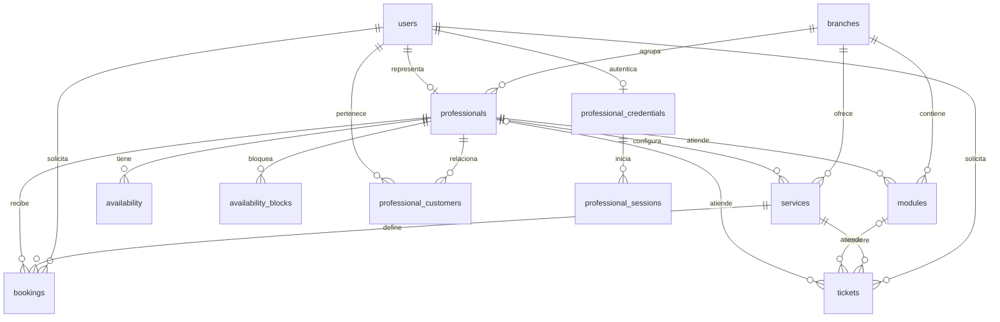
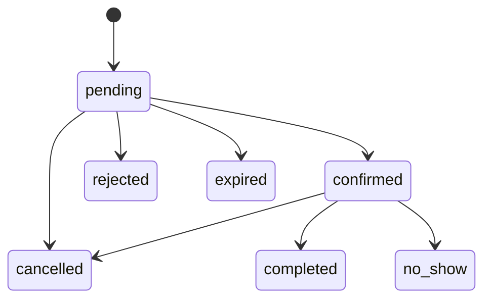
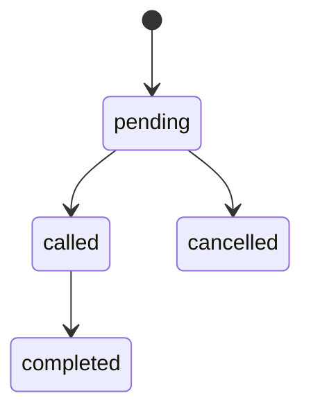

# Diseño del Hito 3

## Diagnóstico y continuidad

El Taller 2 resolvía solicitudes de barbería con React y almacenamiento del navegador. Se recuperan su perfil y panel profesional originales: «Tu jornada», Solicitudes, Agenda, Clientes, Finanzas, Servicios y Ajustes. Sus adaptadores consultan y escriben en la API sin respaldo operacional local. PostgreSQL aporta persistencia e integridad; MongoDB, trazabilidad.

La fuente de producto es [BarberBook/main](https://github.com/MartinCerpa/BarberBook/tree/main), consultada sin modificarla: `docs/decisions.md`, `roadmap.md`, `user-feedback.md`; `skills/01-product-vision.md`, `02-ux-rules.md`, `03-frontend-design.md`, `04-architecture.md`, `05-testing.md`, `08-user-feedback.md` y código original. Se reutilizan sus componentes y estilos. El propietario informa aprobación de BarberBook en Taller 2; corresponde revisar con el docente la adaptación del Hito 3.

Sucursales, módulos y fila FIFO responden al caso oficial 3.3 y permanecen en una extensión académica separada, con acceso administrativo. No dominan el Dashboard ni la navegación profesional; se conservan código y datos existentes.

Historias priorizadas: como cliente, reservar un intervalo disponible; como barbero, decidir solicitudes y consultar agenda; como recepción, emitir y llamar turnos; como administrador, mantener sucursales y catálogos; como responsable, consultar espera, historial y eventos. Todos esos flujos tienen operaciones reales.

## Separación de responsabilidades

| Ubicación | Función |
| --- | --- |
| `src/pages/PublicBarberPage.jsx` | Perfil, selección de profesional y catálogo desde API |
| `src/components/booking/BookingFlow.jsx` | Pasos originales conectados a HTTP |
| `src/hooks/useApiAvailability.js` | Consulta asíncrona, cancelación y reintento |
| `src/pages/AdminPanelPage.jsx` y páginas originales | Jornada, solicitudes, agenda, clientes, finanzas y ajustes desde API |
| `src/components/ProfessionalGate.jsx` | Login, restauración de sesión y protección del panel |
| `src/services/remoteState.js` | Copia remota en memoria, escrituras serializadas y actualización |
| `src/pages/ApiAdminPanel.jsx`, `src/components/fullstack/` | Extensión académica separada |
| `shared/financial.js` | Cálculos puros comunes; backend entrega resúmenes canónicos por período |
| `src/services/api.js` | Fetch, JSON, errores y fecha de negocio |
| `server/routes/` | Registro de endpoints y validación de entradas |
| `server/controllers/` | Traducción de HTTP a servicios y códigos de éxito |
| `server/services/` | Reglas de negocio, transacciones y SQL parametrizado |
| `server/repositories/` | Catálogos, proyecciones, identidad, bloqueos y migraciones |
| `server/validations/` | Esquemas Zod usados en validación y OpenAPI |
| `server/config/` | Variables, aislamiento y conexiones |
| `server/migrations/` | Cambios versionados y semilla reproducible |

`App.jsx` monta el panel original bajo `ProfessionalGate`. Solo `#/academic/...` monta `ApiAdminPanel`. Los caminos locales históricos permanecen bajo las 74 pruebas Node, sin utilizarse como respaldo en el navegador. El portafolio decorativo y el tema visual conservan la implementación anterior.

## Modelo relacional



Las entidades tienen PK y FK. Las FK compuestas impiden asociaciones de sucursales incompatibles. `professional_customers` mantiene historial y confianza por profesional; cada servicio tiene propietario profesional. Teléfono normalizado y nombre permiten recuperar su relación previa: no hay unicidad global de teléfono y familiares con nombres distintos son clientes separados. Precio y duración son snapshots que no cambian al editar servicios. Los clientes reservan sin cuenta.

`availability` representa días semanales con intervalos de minutos. Una exclusión impide jornadas solapadas. `availability_blocks` contiene cierres puntuales. `bookings` guarda inicio/término en `timestamptz`; se convierten las entradas locales usando `AT TIME ZONE 'America/Santiago'`, independientemente del huso del contenedor.

Una exclusión GiST sobre profesional e intervalo `[inicio,fin)` protege atenciones confirmadas, completadas e inasistencias. Las pendientes pueden competir: confirmar una expira las solapadas. Permite intervalos adyacentes y rechaza solapados. Rechazar/cancelar libera el intervalo. CHECK valida duración, precio y estados. Los módulos y profesionales admiten solo un turno llamado simultáneamente.

Las migraciones 001–003 conservan estructura, semilla e historia; 004 incorpora autenticación, propiedad profesional, preferencias y deshacer; 005 distingue solicitudes de atenciones realmente confirmadas; 006 conserva intervalos de días desactivados y corrige la descripción inicial al restaurar el perfil. Se registran en `schema_migrations` bajo bloqueo y transacción; reiniciar no reinicializa ni borra operaciones ni volúmenes.

## Estados y concurrencia

Una reserva debe ser futura, cumplir la anticipación mínima y caber completa en la jornada. El horizonte configurable es 7, 14 o 30 días; la oferta pública mantiene inicios cada 60 minutos desde cada intervalo. Bloqueos, atenciones ocupantes y turnos incompatibles impiden solicitar/reprogramar. El servidor revalida todas las escrituras.



Repetir el mismo estado no agrega otro evento. Completar exige alcanzar el término previsto; inasistencia exige 15 minutos desde el inicio. Solo pendiente/confirmada admite reprogramación. Deshacer confirmación, rechazo o cancelación requiere token propio, máximo dos minutos y versiones sin cambios posteriores; restaura competidoras y deja trazabilidad. No deshace resultados completados o inasistencias. La jornada profesional valida la cobertura de cada reserva futura; la extensión académica mantiene una protección más restrictiva por día semanal.

La confirmación puede ser manual o automática; un cliente con aprobación manual obligatoria nunca se confirma automáticamente. Dos inasistencias activan esa condición y el profesional puede rehabilitarlo. Las solicitudes pueden vencer en 15, 30, 60 minutos o no vencer. Se registran cancelaciones tardías. Finanzas usa precio histórico y zona de Chile, con períodos Hoy/Esta semana/Este mes: solo completadas generan ingresos.

Preferencias, jornada y servicios tienen guardado validado. Cerrar y reabrir un día conserva sus intervalos. El perfil se guarda manualmente y solo admite campos editables, sin metadatos internos.



El llamado elige el pendiente más antiguo de la sucursal y asigna módulo/profesional. El número SQL resuelve empates. La duración debe caber en la jornada actual sin invadir reservas ni bloqueos. Un módulo o barbero con un turno llamado no recibe otro hasta finalizarlo.

Reservas y llamados comparten un bloqueo asesor transaccional por profesional. La fila usa `FOR UPDATE SKIP LOCKED`; las decisiones se confirman en transacciones. Las restricciones SQL refuerzan integridad aunque haya concurrencia. Crear con el mismo `id` y contenido recupera la operación; reutilizar el identificador con otro contenido produce 409.

## MongoDB y outbox

Colección `events`, base `barberbook_hito3`:

```json
{
  "_id": "uuid-del-evento",
  "entityType": "ticket",
  "entityId": "uuid-del-turno",
  "action": "ticket.called",
  "occurredAt": "BSON Date",
  "metadata": { "moduleId": "module-demo", "professionalId": "professional-matias", "status": "called" }
}
```

Registra reservas creadas, confirmadas, rechazadas, canceladas, completadas, inasistencias y actualizaciones; turnos emitidos, llamados, completados y cancelados. Conserva contexto variable de acciones heterogéneas, sin copiar clientes, teléfonos ni reservas completas. SQL mantiene la verdad operacional y las métricas; MongoDB aporta una bitácora común consultable por entidad.

La operación y su evento pendiente se confirman juntos en `event_outbox`. Cada tres segundos el backend hace `upsert` por UUID en MongoDB y marca la entrega SQL. Una interrupción entre ambos pasos se recupera sin duplicar eventos. `/events` también intenta la entrega antes de consultar. No hay atomicidad distribuida: la consistencia es eventual. `/health` informa los pendientes.

Índices: `_id` único, `(entityId,occurredAt)` y `occurredAt`. El outbox es una bandeja técnica de entrega, no una falsa demostración de persistencia NoSQL: el endpoint devuelve documentos de la colección real.

## REST y errores

| Métodos | Ruta bajo `/api` | Operación |
| --- | --- | --- |
| GET, POST; GET, PATCH, DELETE por id | `/branches`, `/services`, `/professionals`, `/modules` | Catálogos; DELETE desactiva |
| GET | `/availability` | Oferta por profesional, servicio, fecha inicial y días |
| GET; PUT | `/availability/weekly`; `/availability` | Leer y reemplazar jornada de un día |
| GET, POST; DELETE por id | `/availability/blocks` | Bloqueos puntuales |
| GET, POST; GET, PATCH por id | `/bookings` | Solicitud, consulta, agenda, reprogramación |
| PATCH | `/bookings/{id}/status` | Transiciones de reserva |
| GET, POST; GET por id | `/tickets` | Emisión y consulta |
| POST | `/tickets/next` | Llamado FIFO con `moduleId` |
| PATCH | `/tickets/{id}/status` | Finalizar/cancelar |
| GET | `/metrics`, `/customers`, `/history`, `/events`, `/health` | Indicadores, historial y estado |

Éxito: `{data: ...}`. Error: `{error: {message, details?}}`. HTTP: 200 consulta/actualización/reintento, 201 creación, 400 validación, 404 inexistente/cola vacía, 409 integridad/ocupación/estado, 422 jornada/fecha, 503 fallo de conexión y 500 error interno oculto. No se exponen credenciales ni mensajes internos del driver.

Swagger deriva las rutas y entradas del mismo registro que usa Express; añade modelos de salida y errores. Referencias: [Express](https://expressjs.com/en/guide/error-handling/), [transacciones node-postgres](https://node-postgres.com/features/transactions), [rangos PostgreSQL](https://www.postgresql.org/docs/current/rangetypes.html), [upsert MongoDB](https://www.mongodb.com/docs/drivers/node/current/crud/update/).

## Navegación y operación

El recorrido principal usa `#inicio` y `#/panel/dashboard`, `requests`, `schedule`, `clients`, `settings`, `services`, `finances`. Las tarjetas de Tu jornada enlazan Solicitudes, Agenda y Finanzas. Cada acción escribe en el servidor y vuelve a consultar. Matías es el perfil público principal; no hay selector si solo existe uno activo y público. Los registros técnicos permanecen en la base sin aparecer en el perfil.

## Autenticación y alcance

`professional_credentials` guarda email y hash scrypt con sal aleatoria. `professional_sessions` almacena solo el hash del token de sesión, CSRF y vencimiento de ocho horas. Cookie HttpOnly/SameSite Strict, revocación SQL en logout y token CSRF en escrituras. Login limita intentos fallidos; en localhost se admite HTTP. Un despliegue HTTPS debe activar cookie Secure. No se implementan recuperación de contraseña ni segundo factor.

`/api/auth/login`, `/session` y `/logout` gestionan acceso. `/api/professional/state` entrega exclusivamente datos propios; `/preferences`, `/hours`, `/profile`, `/services`, `/customers/:id/trust`, `/slots` y `/undo` validan las escrituras. Consultas y mutaciones de reservas, clientes y eventos se filtran por profesional; recursos de la extensión requieren permiso administrativo. Sin sesión se devuelve 401; CSRF/permiso inválido, 403; límite de login, 429. Swagger documenta cookie y cabecera CSRF.

`npm run auth:setup` genera la contraseña inicial de Matías en un archivo privado ignorado. No hay contraseña predeterminada en el repositorio. La demostración sigue limitada a localhost y datos ficticios; ver README para habilitar expresamente la extensión académica sin cambiar la contraseña.
