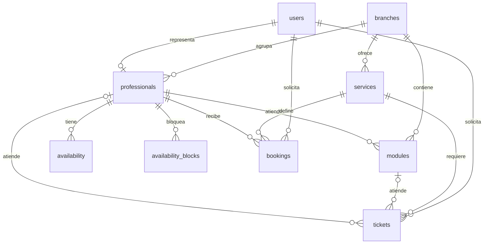
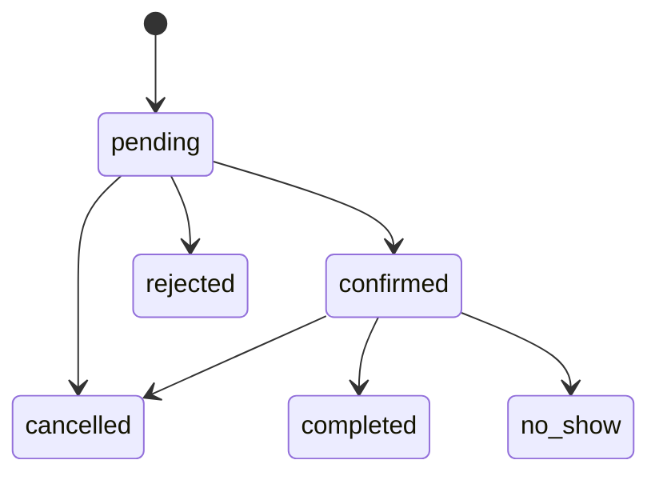
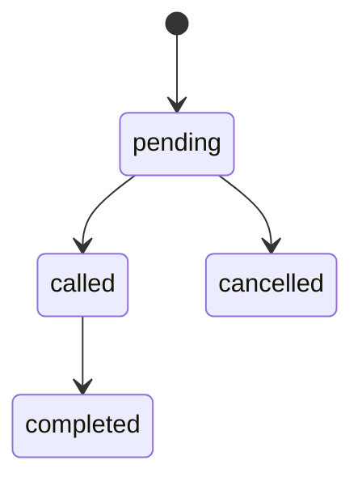

# Diseño del Hito 3

## Diagnóstico y continuidad

El Taller 2 resolvía solicitudes de barbería con React, datos simulados y almacenamiento del navegador. Faltaban un servidor común, persistencia entre dispositivos, integridad ante concurrencia y trazabilidad centralizada. Se conserva el problema y la interfaz pública. El panel remoto reutiliza layout, tema y tarjetas, con componentes de gestión nuevos.

Se amplía hacia el caso 3.3 del enunciado: una sucursal ofrece servicios; funcionarios/barberos atienden en módulos/sillones. Las reservas anticipadas y la fila presencial son procesos diferentes que comparten disponibilidad profesional. Es una justificación de continuidad, no una aprobación del docente.

Historias priorizadas: como cliente, reservar un intervalo disponible; como barbero, decidir solicitudes y consultar agenda; como recepción, emitir y llamar turnos; como administrador, mantener sucursales y catálogos; como responsable, consultar espera, historial y eventos. Todos esos flujos tienen operaciones reales.

## Separación de responsabilidades

| Ubicación | Función |
| --- | --- |
| `src/pages/PublicBarberPage.jsx` | Perfil, selección de profesional y catálogo desde API |
| `src/components/booking/BookingFlow.jsx` | Pasos originales conectados a HTTP |
| `src/hooks/useApiAvailability.js` | Consulta asíncrona, cancelación y reintento |
| `src/pages/ApiAdminPanel.jsx` | Carga y coordinación del panel remoto |
| `src/components/fullstack/` | Formularios y gestión de reservas, fila, catálogos y jornadas |
| `src/services/api.js` | Fetch, JSON, errores y fecha de negocio |
| `server/routes/` | Registro de endpoints y validación de entradas |
| `server/controllers/` | Traducción de HTTP a servicios y códigos de éxito |
| `server/services/` | Reglas de negocio, transacciones y SQL parametrizado |
| `server/repositories/` | Catálogos, proyecciones, identidad, bloqueos y migraciones |
| `server/validations/` | Esquemas Zod usados en validación y OpenAPI |
| `server/config/` | Variables, aislamiento y conexiones |
| `server/migrations/` | Cambios versionados y semilla reproducible |

`App.jsx` usa `ApiAdminPanel`; no hay rutas activas al panel local histórico. No existe respaldo operacional en localStorage ante una falla de API. El portafolio decorativo y el tema visual conservan la implementación anterior.

## Modelo relacional



Las entidades tienen PK y FK. Las FK compuestas impiden asociar profesionales, servicios y módulos de sucursales incompatibles. Los usuarios representan clientes o funcionarios; los roles no constituyen autenticación. El teléfono chileno normalizado identifica al cliente, mientras que el nombre ingresado se conserva por operación. Precio y duración son snapshots para no alterar atenciones históricas al editar servicios.

`availability` representa días semanales con intervalos de minutos. Una exclusión impide jornadas solapadas. `availability_blocks` contiene cierres puntuales. `bookings` guarda inicio/término en `timestamptz`; se convierten las entradas locales usando `AT TIME ZONE 'America/Santiago'`, independientemente del huso del contenedor.

Una exclusión GiST sobre profesional e intervalo `[inicio,fin)` protege reservas pendientes, confirmadas, completadas e inasistencias. Permite intervalos adyacentes y rechaza solapados. Rechazar/cancelar libera el intervalo. CHECK valida duración, precio y estados. Los módulos y profesionales tienen índices únicos parciales para admitir solo un turno llamado simultáneamente.

Las migraciones 001 (estructura), 002 (semilla) y 003 (nombres históricos) se registran en `schema_migrations`. Se aplican bajo un bloqueo y una transacción; reiniciar no reinicializa ni borra operaciones.

## Estados y concurrencia

Una reserva debe ser futura, dentro de 60 días y caber completa en la jornada. La UI ofrece 14 días con inicios cada 15 minutos. Bloqueos, reservas ocupantes y atenciones presenciales incompatibles impiden solicitar/reprogramar. El servidor revalida todas las escrituras; el estado de la pantalla no es autoridad.



Los estados terminales no vuelven a pendiente. Repetir el mismo estado no agrega otro evento. Completar exige alcanzar el término previsto; inasistencia exige 15 minutos desde el inicio. Solo pendiente/confirmada admite reprogramación. Cambiar la jornada de un día semanal con reservas futuras devuelve 409 y conserva compromisos.



El llamado elige el pendiente más antiguo de la sucursal y asigna módulo/profesional. El número SQL resuelve empates. La duración debe caber en la jornada actual sin invadir reservas ni bloqueos. Un módulo o barbero con un turno llamado no recibe otro hasta finalizarlo.

Reservas y llamados comparten un bloqueo asesor transaccional por profesional. La fila usa `FOR UPDATE SKIP LOCKED`; las decisiones se confirman en transacciones. Las restricciones SQL refuerzan integridad aunque haya concurrencia. Crear con el mismo `id` y contenido recupera la operación; reutilizar el identificador con otro contenido produce 409.

## MongoDB y outbox

Colección `events`, base `barberbook_hito3`:

```json
{
  "_id": "uuid-del-evento",
  "entityType": "ticket",
  "entityId": "uuid-del-turno",
  "action": "ticket.called",
  "occurredAt": "BSON Date",
  "metadata": { "moduleId": "module-demo", "professionalId": "professional-matias", "status": "called" }
}
```

Registra reservas creadas, confirmadas, rechazadas, canceladas, completadas, inasistencias y actualizaciones; turnos emitidos, llamados, completados y cancelados. Conserva contexto variable de acciones heterogéneas, sin copiar clientes, teléfonos ni reservas completas. SQL mantiene la verdad operacional y las métricas; MongoDB aporta una bitácora común consultable por entidad.

La operación y su evento pendiente se confirman juntos en `event_outbox`. Cada tres segundos el backend hace `upsert` por UUID en MongoDB y marca la entrega SQL. Una interrupción entre ambos pasos se recupera sin duplicar eventos. `/events` también intenta la entrega antes de consultar. No hay atomicidad distribuida: la consistencia es eventual. `/health` informa los pendientes.

Índices: `_id` único, `(entityId,occurredAt)` y `occurredAt`. El outbox es una bandeja técnica de entrega, no una falsa demostración de persistencia NoSQL: el endpoint devuelve documentos de la colección real.

## REST y errores

| Métodos | Ruta bajo `/api` | Operación |
| --- | --- | --- |
| GET, POST; GET, PATCH, DELETE por id | `/branches`, `/services`, `/professionals`, `/modules` | Catálogos; DELETE desactiva |
| GET | `/availability` | Oferta por profesional, servicio, fecha inicial y días |
| GET; PUT | `/availability/weekly`; `/availability` | Leer y reemplazar jornada de un día |
| GET, POST; DELETE por id | `/availability/blocks` | Bloqueos puntuales |
| GET, POST; GET, PATCH por id | `/bookings` | Solicitud, consulta, agenda, reprogramación |
| PATCH | `/bookings/{id}/status` | Transiciones de reserva |
| GET, POST; GET por id | `/tickets` | Emisión y consulta |
| POST | `/tickets/next` | Llamado FIFO con `moduleId` |
| PATCH | `/tickets/{id}/status` | Finalizar/cancelar |
| GET | `/metrics`, `/customers`, `/history`, `/events`, `/health` | Indicadores, historial y estado |

Éxito: `{data: ...}`. Error: `{error: {message, details?}}`. HTTP: 200 consulta/actualización/reintento, 201 creación, 400 validación, 404 inexistente/cola vacía, 409 integridad/ocupación/estado, 422 jornada/fecha, 503 fallo de conexión y 500 error interno oculto. No se exponen credenciales ni mensajes internos del driver.

Swagger deriva las rutas y entradas del mismo registro que usa Express; añade modelos de salida y errores. Referencias: [Express](https://expressjs.com/en/guide/error-handling/), [transacciones node-postgres](https://node-postgres.com/features/transactions), [rangos PostgreSQL](https://www.postgresql.org/docs/current/rangetypes.html), [upsert MongoDB](https://www.mongodb.com/docs/drivers/node/current/crud/update/).

## Navegación y operación

Se mantienen `#inicio` y `#/panel/requests`, `schedule`, `clients`, `settings`; se incorporan `queue`, `history`, `services`, `finances`. Cada acción invoca una operación real y vuelve a consultar el servidor. Una falla de eventos no impide usar los recursos SQL ya cargados. No se implementa seguridad de producción; la demostración se limita a localhost y datos ficticios.
