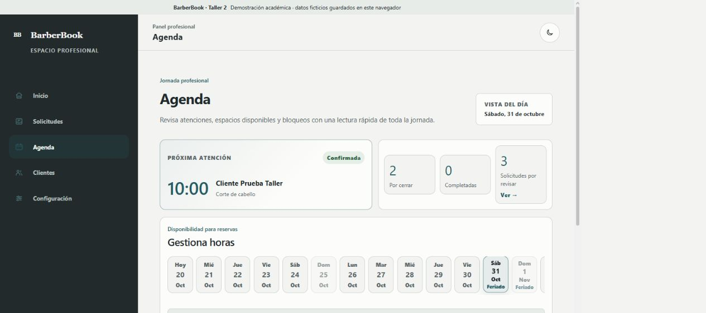

# Validación de la versión académica

Última ejecución automatizada: 20 de octubre de 2026.

## Qué se probó

- Reglas locales de horarios, disponibilidad y reservas.
- Envío, confirmación, rechazo y persistencia de solicitudes.
- Resúmenes de Agenda y datos de clientes.
- Consulta y normalización de feriados.
- Traducción centralizada de nombres y conservación de fechas.
- Respuestas vacías, datos inválidos, errores y reintento de la API.

## Cómo se probó

Se ejecutó `npm test`, que utiliza `node:test` y datos controlados. Estos datos permiten reproducir respuestas válidas y errores sin modificar la API ni depender de su disponibilidad durante cada prueba.

También se ejecutaron anteriormente `npm run lint` y `npm run build` para comprobar el código y la compilación de producción.

## Resultado comprobado

- `npm test`: **74 pruebas aprobadas y 0 fallidas**.
- La última revisión registrada de lint terminó sin incidencias.
- La última compilación registrada terminó correctamente.
- La integración usa el endpoint v4 de Nager.Holidays y conserva la reserva local cuando la API falla.

El conteo de 74 pruebas se verificó nuevamente antes de actualizar este documento. No se presenta como prueba visual ni como garantía de todos los navegadores.

## Evidencia disponible

La captura muestra:

- la Agenda del panel en tema oscuro;
- una atención confirmada;
- espacios disponibles;
- indicadores de feriado en el selector de días.

Esta imagen aporta evidencia del panel, la Agenda y la integración visual de feriados en escritorio. No demuestra por sí sola el Fetch, la traducción completa del nombre ni la adaptación móvil.

No existen actualmente otras capturas dentro de `docs/evidencias/`. Por lo tanto, no se afirma evidencia visual del perfil, formulario, solicitud recibida o vista móvil.

## Limitaciones pendientes

- Conviene capturar, desde la aplicación real, el perfil con servicios, el formulario validado, un feriado con nombre en español, una solicitud recibida y una vista móvil.
- Las pruebas automatizadas no reemplazan una revisión manual completa del recorrido.
- No se verificaron todos los navegadores ni todos los tamaños posibles.
- La persistencia es local y el panel no tiene autenticación.

Antes de entregar, el estudiante debe repetir el recorrido principal, revisar las capturas que agregue y confirmar personalmente que las afirmaciones de este documento siguen vigentes.
